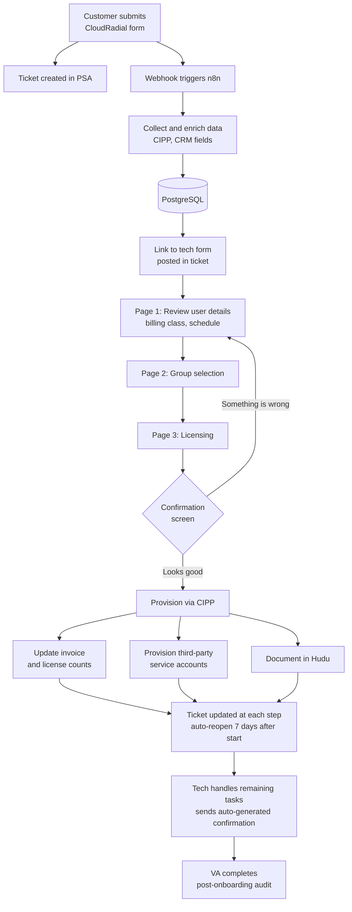
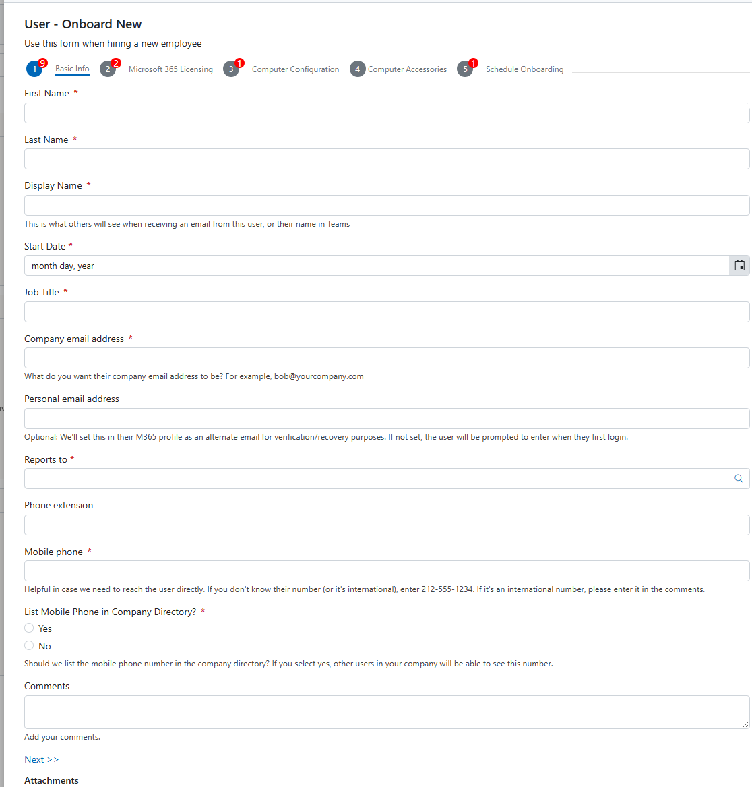
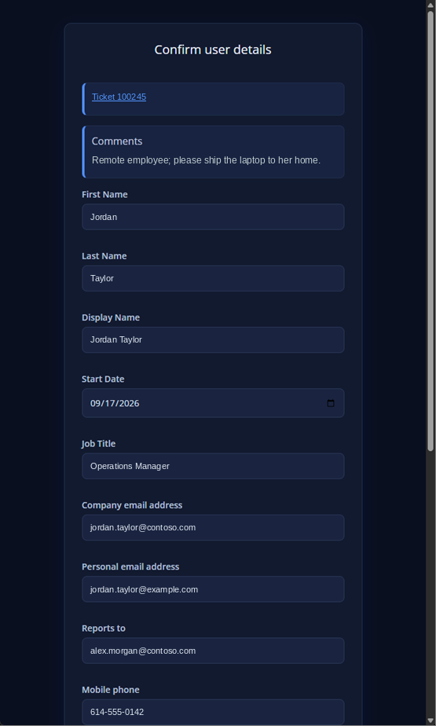
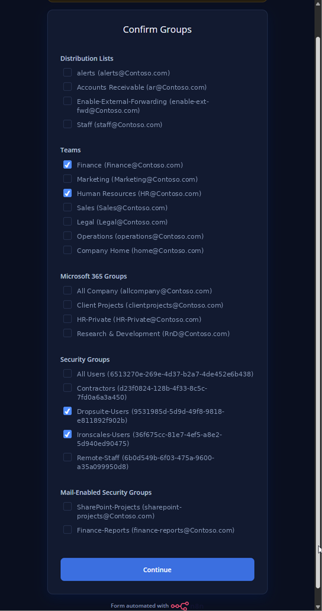
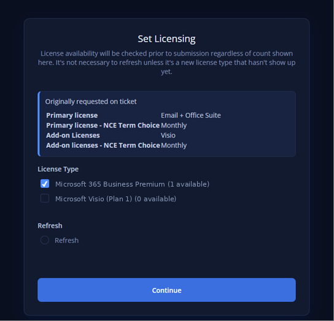
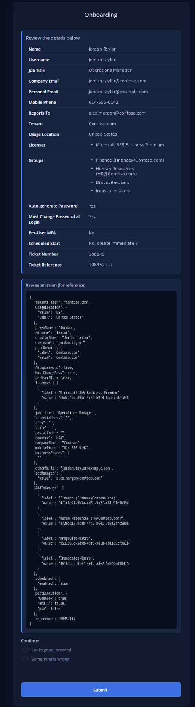

# Automated User Onboarding for an MSP

An end-to-end onboarding pipeline that takes a new-user request from a customer portal all the way through account provisioning, licensing, billing updates, and documentation, with a technician review step in the middle to keep a human in control.

Built for a managed services provider (SkyCamp Technologies) supporting 30+ client organizations on Microsoft 365.

> **Result:** Per-user onboarding effort dropped from about **1 hour to 10 to 15 minutes**. For a typical new user, a technician now spends more time helping them set up MFA than running the entire onboarding process.

---

## Table of Contents

- [The Problem](#the-problem)
- [Tech Stack](#tech-stack)
- [Architecture](#architecture)
- [Workflow Walkthrough](#workflow-walkthrough)
- [Design Decisions](#design-decisions)
- [Outcomes](#outcomes)

---

## The Problem

Onboarding a user at an MSP touches a lot of systems: the customer's Microsoft 365 tenant, licensing, security groups, third-party services, the PSA ticket, the customer's invoice, and documentation. Done manually, each onboarding meant:

- Re-keying information from the request into multiple admin portals
- Remembering which customer-specific services each client pays for
- Updating invoice quantities by hand (and occasionally forgetting)
- Writing up documentation after the fact
- Hunting for customer-specific procedures and notes

The goal was to automate everything repeatable, while still letting a technician review and correct the data before anything was provisioned.

---

## Tech Stack

| Layer | Tool | Role |
|---|---|---|
| Customer portal | CloudRadial | Customer submits the new-user request form |
| Orchestration | **n8n** | Webhook intake, data processing, dynamic multi-page technician forms, provisioning logic |
| Data store | PostgreSQL | Holds request data and state between workflow stages |
| M365 management | CIPP | Group and license lookups, user creation in the customer tenant |
| PSA / CRM | Syncro | Tickets, invoices, and company service flags |
| Documentation | Hudu | Onboarding records and customer-specific procedures |
| Endpoint management | Intune, Autopilot | Applies software and policies once a device is assigned |

---

## Architecture

---

## Workflow Walkthrough

### 1. Customer submits the request

The customer fills out a new-user form in the CloudRadial portal. It collects:

- Basic user information
- Licensing choices
- Computer configuration
- Group, Team, and distribution list memberships
- Any custom questions specific to that customer

The group list on the form is synced from the customer's own tenant, with a filter that only exposes groups the customer should be able to see.

### 2. Ticket and webhook

Submitting the form creates a ticket in the PSA and fires a webhook to n8n. The workflow performs the initial processing and data collection, writes everything to PostgreSQL, and posts a link to the technician form directly in the ticket.

### 3. Technician review: user details

The first page of the technician form shows:

- A link back to the ticket
- The customer's comments from the request
- Every submitted field, editable, in case the customer made a mistake
- **User classification for billing** (full managed user, mobile user, licensing only, and so on, each with a different rate)
- Whether to onboard now or schedule for a later date

### 4. Technician review: groups

The group page defaults to whatever the customer selected, and the technician can add or change anything. Unlike the customer-facing form, this list shows **every** group of every type in the tenant, pulled live through CIPP.

Some services provision automatically based on security group membership (for example Ironscales or Dropsuite). The workflow checks the company's service flags in the CRM and **pre-selects those groups automatically**, so the technician doesn't have to remember them and the customer always gets the services they're paying for.

### 5. Technician review: licensing

This page shows the licensing the customer requested alongside the licenses currently available in the tenant, pulled from CIPP. If more licenses are needed, the technician can purchase them and click **Refresh** to see them as options without leaving the form.

### 6. Confirmation

A final screen shows the complete data set along with the raw JSON payload.

- **Looks good:** submits to CIPP and continues to provisioning
- **Something is wrong:** returns to the first page for corrections

### 7. Provisioning and follow-through

Once confirmed, the workflow:

- Creates the user in the customer's Microsoft 365 tenant via CIPP
- **Updates the customer's invoice** to add the new user and adjust other license counts
- Creates accounts in any additional services that need them
- Documents the onboarding data and results
- Updates the ticket at every step
- Sets the ticket to **auto-reopen 7 days after the user's start date** so the team can check in with the user

The customer-specific onboarding procedure is added to the ticket as a comment, and all relevant information is either in the ticket or linked to the knowledge base. The technician only needs to resolve any issues, complete tasks that aren't automated yet, and send the auto-generated confirmation to the customer.

### 8. Audit

A virtual assistant completes a post-onboarding audit form to verify that every step was done.

---

## Design Decisions

**Why n8n?** Its support for dynamic, multi-page forms was the deciding factor. Each page is submitted, processed, and used to build the next page on the fly, which feels seamless to the technician while allowing live lookups between steps.

**Why CIPP?** CIPP provides a unified API across all customer tenants. Building this directly against Microsoft Graph for 30+ tenants is possible, but would mean far more setup, upkeep, and complex queries.

**Why keep a human in the loop?** Customers make mistakes on forms, and some decisions (billing classification, extra groups, license purchases) need judgment. The review step catches errors before anything is provisioned, while the automation handles the repetitive work around it.

**Why tie it to billing?** Revenue leaks most often come from forgotten invoice updates. Making the invoice update part of the same workflow as account creation means a user can't be onboarded without being billed.

---

## Outcomes

| Metric | Before | After |
|---|---|---|
| Technician time per onboarding | ~1 hour | 10 to 15 minutes |
| Weekly volume handled | 5 to 10 users | Same volume, a fraction of the effort |
| Invoice updates | Manual, sometimes missed | Automatic on every onboarding |
| Service group assignment | From memory or manual lookup | Pre-selected from CRM service flags |
| Documentation | Written after the fact | Generated automatically |
| Follow-up with the new user | Ad hoc | Ticket auto-reopens 7 days after start |

Combined with Intune and Autopilot, once a device is assigned to the user, all software and policies are applied automatically, so the user is ready to work on day one.

---

*Related: a separate workflow handles computer purchasing and provisioning, from invoice parsing through Autopilot registration and billing.*
